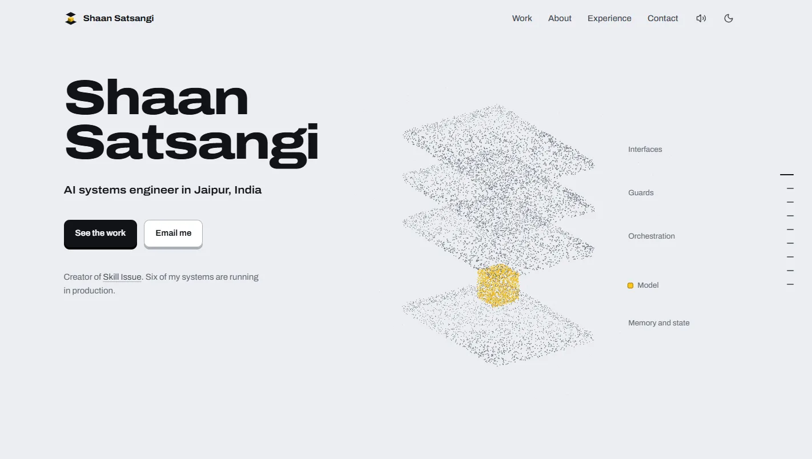
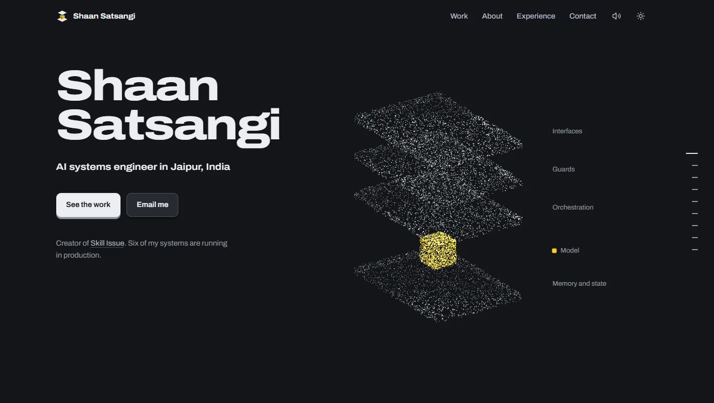
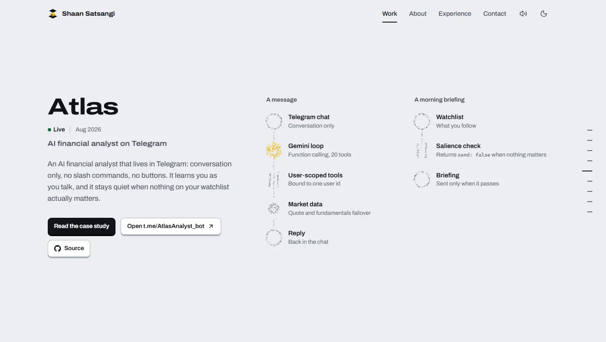

# Shaan Satsangi — Portfolio

The personal site of an AI systems engineer, built with **Next.js 16**, **React 19**, **Tailwind CSS 4** and **three.js**. It is organised around one idea, drawn the same way everywhere on the page:

> "The model is a component, not the architecture."

<p align="center">
  
  
</p>

## Design

- **One idea, in dots.** Grey dots are the system and yellow dots are the model, the only warm colour on the page. Every scene says "the model is a component" without needing a caption.
- **A film at the top.** Nine full-screen scenes, one per scroll gesture:
  - **The hero:** the stack, a layered drawing of a system with the model as one yellow cube.
  - **The thesis:** the stack becomes one flow.
  - **Selected work:** the six systems side by side.
  - **One scene per system.**
- **Smooth before anything else.**
  - **Scrolling:** native CSS snap, plus one small rule: a wheel gesture moves exactly one scene. Touch, keys and the scrollbar use snap alone. Both apply only after a hidden test shows the browser handles snap properly.
  - **The morphs** run on their own clock and never on the scroll position, so a mouse-wheel notch can never make the dots jump.
- **One field of dots.**
  - **It is one three.js `Points` draw call:** 16,000 dots on a desktop and fewer on phones.
  - **Its motion** is computed entirely in the vertex shader.
  - **The CPU** mirrors the same maths ([`morph.ts`](src/components/field/morph.ts)). On a scene change, every dot starts exactly where it is, with the same colour and size.
- **Each system's guard does its job, taken from its own text.** A table ([`behaviours.ts`](src/components/field/behaviours.ts)) gives each system's dots a small program:

  | System | What its dots do |
  |---|---|
  | Skill Issue | The score is a rigid grid that the narrator never enters. |
  | Atlas | The briefing stops at its salience check and lets one packet through now and then. |
  | Syntrueno | It waits at the human gate for a single-use approval. |
  | AI Reel Factory | It sends out six pitches and lets three continue through the fact-check. |
  | VouchRank | The audit runs inside the agency's workspace, and consent filters nothing. |
  | Think9 Brain | It holds back superseded documents and turns some answers around. |

- **Every fact stays in HTML.**
  - **The dots form on real HTML markers,** with each step's label and note beside them.
  - **"Read the case study"** opens a sheet with the bullets, the stack and the links.
  - **Ticks on the right edge** list the scenes.
  - **After the film,** the archive, About, Experience and Contact scroll normally. The film ends on one hairline, which becomes the header's.
- **Fallbacks.**
  - **Without WebGL, with Save-Data, after a lost graphics context, or in a browser that fails the snap test,** every step shows as a tile and the hero keeps its drawing.
  - **With reduced motion,** each scene appears in its final shape after a 200 ms fade, and each system's behaviour is a still frame.
  - **Without JavaScript,** the case studies read in place.
- **Type and colour.**
  - Archivo at two widths: expanded for display, normal for reading.
  - The neutrals are cool aluminium in light mode and graphite in dark, plus one signal colour that only ever means "a model runs here". The portrait is grayscale, for the same reason.
  - Every text colour clears WCAG AA in both themes, and axe reports no violations.
- **Sound that answers you.**
  - **What makes a sound:** keys click as they bottom out, and the theme toggle is a light switch. The menu, the case-study sheet, Copy and the contact form each have their own cue.
  - **What doesn't:** nothing plays on load, hover or scroll. The speaker in the header mutes it and remembers.
  - **Where the sounds come from:** [uisfx](https://github.com/romainsimon/uisfx)'s studio pack, synthesized in the page from recipes rather than audio files, and loaded after first paint.
  - **On iPhone,** the page asks Safari for its ambient audio session, which mixes with your music instead of pausing it and follows the silent switch.

<p align="center">
  
</p>

## Stack

- **Framework:** Next.js 16 (App Router, static export), React 19
- **Styling:** Tailwind CSS 4, design tokens in [`globals.css`](src/app/globals.css)
- **3D:** three.js 0.186. It draws one `Points` call with a custom GLSL 3 shader, lazy-loaded after first paint, and the loop stops whenever nothing moves.
- **Fonts:** Archivo (variable width and weight) via `next/font`
- **Sound:** uisfx 0.4.0 (pinned; MIT code, CC0 sounds), a 12 KB lazy chunk driven by [`src/lib/sound.ts`](src/lib/sound.ts)
- **Hosting:** Cloudflare Workers static assets at [`shaansatsangi.com`](https://shaansatsangi.com).
  - Cloudflare provides DNS, the WAF and the CDN.
  - The edge adds security headers, an enforced CSP and HSTS, and scores **A+** on SSL Labs.
- **Contact API:** a same-origin Cloudflare Worker route (`/api/contact`, see [`worker/index.ts`](worker/index.ts)) that emails via **Resend**.
  - **It checks:**
    - a honeypot;
    - required fields and their lengths;
    - the type of every field;
    - a streamed 24 KB body cap, which leaves room for a full-length message in a three-byte script such as Devanagari.
  - **It refuses** cross-site browser requests.
  - **Testing:** a `node:test` suite covers all of these.
  - **Rate limiting** is a Cloudflare WAF rule in front of it.
  - No CORS, no cold start.

## Layout of the code

```
src/content/            the content data: profile, projects (with their flows), skills, experience, the stack's layers
src/components/film/    the film: its scenes (hero, thesis, work, one per system), the case-study sheet, the scene
                        ticks, and Film.tsx, which reads the page's layout and drives the field
src/components/field/   the dot field: morph.ts (the motion maths the shader mirrors), targets.ts (every scene's dots),
                        behaviours.ts (what each system's dots do), shaders.ts, engine.ts (three.js), and wheel.ts and
                        snap.ts (one scene per wheel gesture)
src/components/stack/   the stack drawing: the hero's first paint and fallback, and the social card
scripts/                the build stamp
src/app/og.png/         the social card, rendered at build time with next/og
worker/                 the Cloudflare Worker and its tests
```

## Featured projects

**Live in production**

- **Skill Issue** — AI-powered GitHub intelligence platform: a deterministic 100-point engineering score and shareable receipts, live at [skillissue.tech](https://skillissue.tech). The score is computed; the model only narrates it. *Next.js · FastAPI · Neon Postgres · Upstash Redis · Groq.*
- **Atlas** — an AI financial analyst that lives in [Telegram](https://t.me/AtlasAnalyst_bot): conversation-only, 20 Gemini-function-calling tools (the 10 that touch user data are closure-bound to one user), a four-provider quote failover chain, and briefings gated on a salience check that returns `send: false` and means it. *Python · Gemini · Postgres · SQLAlchemy.*
- **Syntrueno** — zero-trust autonomous cloud-ops swarm, [live on Cloud Run](https://syntrueno-18489510475.us-central1.run.app). Gemini agents diagnose incidents, judge their own remediation plans, and execute real infrastructure changes behind a single-use SHA-256 human gate, then re-read live state until it converges. *Python · Gemini · Cloud Run · Firestore.*
- **AI Reel Factory** — on-demand, low-cost content pipeline: researches news, writes scripts, narrates in a near-human voice, generates AI B-roll, renders captioned vertical video, and publishes YouTube Shorts to [@butitmatters](https://www.youtube.com/channel/UC5rDIoOPYLrHaf2IQ5hRlRw) after a `/makeshort` and an Approve tap in Telegram. *Python · Gemini · Cloudflare Workers AI · Supabase · FFmpeg · faster-whisper · GitHub Actions.*
- **VouchRank** — multi-tenant, white-label reputation & AI-search (AIO/GEO) SaaS for local businesses, [live](https://vouchrank.vercel.app). *React 19 · Vite · Supabase RLS · Stripe · Twilio.*
- **Think9 Brain** — grounded institutional-memory assistant, [live](https://think9-brain.vercel.app). Cites the exact source section, states a good-as-of date, withholds superseded documents; refusal recall 1.000 across 32 unanswerable questions. *Python · LangGraph · FastAPI · Groq.*

**Also shipped**

- **Telegram MCP** — local Model Context Protocol server giving AI agents read/write access to a Telegram account via MTProto. *Python · Telethon · MCP · Claude.*
- **JARVIS** — local-first voice assistant that still works offline: wake-word detection, local LLM inference (Ollama), long-term memory, streaming TTS.
- **Face Sort Studio** — local deep-learning photo organizer (OpenCV DNN: YuNet + SFace) with SQLite persistence and SSE progress.
- **YouTube Wrapped** — Databricks medallion lakehouse (Bronze → Silver → Gold) on Delta Lake, served via FastAPI + Next.js.
- **Sahaara** — mobile-first women's-safety app with one-tap SOS, MapLibre live location, and Supabase Realtime alerts to nearby users.
- **CRM + Sales Warehouse** — Airflow ETL into a star-schema PostgreSQL warehouse, surfaced via Power BI.
- **Cog & Cosmos** — pixel-art interconnected incremental/idle game; eight worlds feed one brass Fortune Engine. *Svelte 5 · TypeScript · PixiJS · PWA.*

## Local development

```bash
git clone https://github.com/Shaan-alpha/Portfolio.git && cd Portfolio
npm install
npm run dev          # http://localhost:3000
npm run build        # static export to ./out, including the social card at /og.png
npm test             # node:test: the field's maths and targets, the film's rules, sound, the contact Worker
npm run typecheck
npm run lint
```

`src/lib/buildInfo.ts` is generated from git by the `predev` / `prebuild` hooks and is not committed. The footer shows it; a build made from uncommitted changes reads `-dirty`, so commit before building a release.

---
Built by **Shaan Satsangi** · Jaipur, Rajasthan
